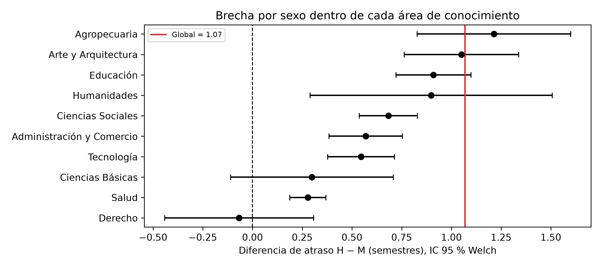
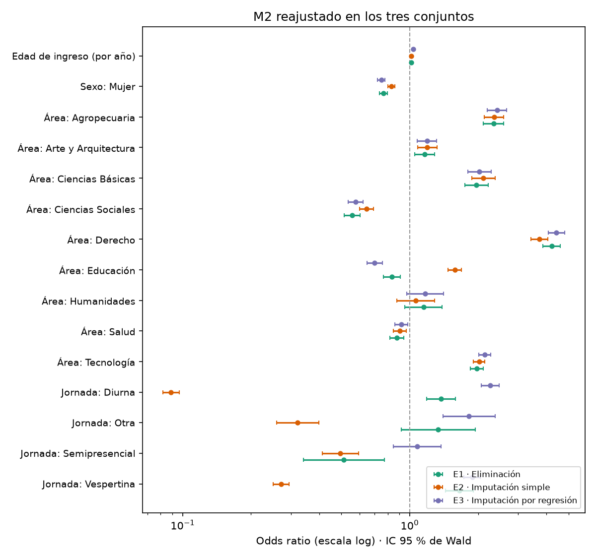

# Atraso en la titulación universitaria en Chile

Análisis estadístico y modelamiento predictivo de la duración real de las carreras de pregrado universitario en Chile, a partir del registro oficial de Titulados en Educación Superior 2025 del Ministerio de Educación (N = 105.063). El proyecto recorre el ciclo completo de un análisis de datos: preparación y calidad de datos, inferencia clásica, validación computacional por remuestreo y simulación, tratamiento de datos faltantes y regresión logística, con énfasis en la reproducibilidad y en la comunicación de resultados para la toma de decisiones.

**Autor:** Jorge Álvarez Ossandón

---

## Problema

¿Cuánto se aparta la duración real de las carreras universitarias de su duración formal, qué factores explican ese atraso y con qué precisión es posible anticipar un atraso alto (más de 4 semestres sobre la duración del plan)?

## Hallazgos principales

| Tema | Resultado |
| :--- | :--- |
| Magnitud del atraso | El titulado típico egresa con 2 semestres de atraso (mediana); la media es 3,40 semestres, IC 95 % [3,37; 3,43]. |
| Brecha por sexo | Los hombres se atrasan 1,07 semestres más que las mujeres (Welch, p < 0,001; d = 0,23). La brecha es robusta en el signo, pero cerca de la mitad se explica por el área de conocimiento: dentro de áreas se reduce a 0,55 semestres. |
| Heterogeneidad institucional | El error estándar jackknife por institución (0,111) es 3,5 veces el de Welch; en el modelo logístico, el bootstrap por universidad ensancha los intervalos entre 1,8 y 9,2 veces respecto de Wald. La incertidumbre entre instituciones domina sobre la del muestreo. |
| Potencia | Según simulación Monte Carlo (binomial negativa), la brecha por sexo solo es detectable con potencia de 80 % en cohortes de unos 700 titulados o más. |
| Datos faltantes | El 12,75 % de los registros no informa el año de ingreso original. El mecanismo es MAR, ligado a la jornada: 75,9 % de faltantes en A Distancia frente a 1,5 % en Diurna (razón 50:1). |
| Imputación simple | Imputar por la mediana infla la tasa de atraso alto de 24,5 % a 32,7 % y destruye una correlación validada (duración formal–atraso pasa de 0,009 a −0,218). Se descarta. |
| Modelo predictivo | El modelo logístico seleccionado (sexo, área, jornada y edad de ingreso; mínimo AIC y BIC) alcanza AUC = 0,662 y exactitud de 65,3 % en un conjunto de prueba común de casos observados (umbral de Youden 0,2246). Derecho (OR = 4,42), Agropecuaria (2,42) e Ingeniería (2,14) elevan el riesgo; ser mujer lo reduce (OR = 0,75). |
| Impacto de la imputación | La imputación por regresión distorsiona los odds ratios de jornada al omitir esa covariable. La imputación múltiple congeniada (m = 20, reglas de Rubin) reduce la discrepancia media con casos completos de 18,5 % a 7,3 % y calibra las probabilidades predichas. |

<p align="center">
  
  
</p>

## Competencias y métodos

| Área | Métodos y herramientas |
| :--- | :--- |
| Preparación de datos | Filtrado del universo de análisis, códigos centinela a nulos, variables derivadas, detección de atípicos (Tukey) sin eliminación apresurada, lógica reutilizable en `src/`. |
| Estadística inferencial | Intervalos *t*, prueba *t* de Welch, chi-cuadrado, tamaños de efecto (*d* de Cohen, V de Cramér), correlación de Spearman. |
| Estadística computacional | Bootstrap percentil y BCa (B = 10.000), pruebas de permutación, jackknife por conglomerado institucional, simulación Monte Carlo de potencia y convergencia. |
| Datos faltantes | Diagnóstico MCAR/MAR, eliminación por lista, imputación simple, imputación por regresión, imputación múltiple con reglas de Rubin. |
| Modelamiento predictivo | Regresión logística, selección por AIC/BIC y *stepwise*, odds ratios con bootstrap por conglomerado, curva ROC, umbral de Youden, prevención de fuga de datos. |
| Reproducibilidad | Python (pandas, NumPy, SciPy, statsmodels, scikit-learn, matplotlib, seaborn), semilla fija 42, entorno virtual con versiones fijadas, Git y GitHub. |

## Etapas del proyecto

| Etapa | Notebook | Contenido |
| :--- | :--- | :--- |
| 1 | [01_exploracion_e_inferencia](notebooks/01_exploracion_e_inferencia.ipynb) | Calidad de datos, variables derivadas, análisis exploratorio, intervalos de confianza y pruebas de hipótesis. |
| 2 | [02_validacion_computacional](notebooks/02_validacion_computacional.ipynb) | Bootstrap, permutación, estabilidad de correlaciones, simulación Monte Carlo y análisis de robustez. |
| 3 | [03_preparacion_e_imputacion](notebooks/03_preparacion_e_imputacion.ipynb) | Mecanismo de pérdida, imputación por regresión, comparación de tres estrategias y partición 70/30. |
| 4 | [04_regresion_logistica](notebooks/04_regresion_logistica.ipynb) | Tres especificaciones logísticas, selección por AIC/BIC, bootstrap por institución y evaluación con umbral de Youden. |
| 5 | [05_impacto_de_la_imputacion](notebooks/05_impacto_de_la_imputacion.ipynb) | Reajuste del modelo en los tres conjuntos, conjunto de prueba común e imputación múltiple. |

Los resultados que conectan cada etapa con la siguiente quedan en `resultados/`.

## Datos

Base oficial de **Titulados en Educación Superior 2025**, Servicio de Información de Educación Superior (SIES), Mineduc.

1. Descargar el conjunto *Educación Superior - Titulados en Educación Superior 2025* desde [datosabiertos.mineduc.cl](https://datosabiertos.mineduc.cl).
2. Guardar el archivo `20260817_Titulados_Ed_Superior_2025_WEB.csv` (separador punto y coma) en `data/raw/`.
3. Los notebooks aplican el filtro a pregrado universitario (`nivel_global == 'Pregrado'` y `tipo_inst_1 == 'Universidades'`), con lo que se obtienen los 105.063 registros analizados.

El archivo crudo no se versiona por su tamaño.

## Estructura del repositorio

```
data/raw/        archivo crudo del Mineduc (no versionado)
notebooks/       los cinco notebooks del análisis, en orden de ejecución
src/             funciones de preparación e imputación (preparacion.py)
figuras/         gráficos generados por los notebooks
resultados/      tablas de resultados en CSV (los parquet se regeneran con el notebook 03)
requirements.txt dependencias con versiones fijadas
```

## Cómo reproducir

```
python -m venv .venv
.venv\Scripts\activate
pip install -r requirements.txt
```

Con el archivo crudo en `data/raw/`, ejecutar los notebooks en orden, del 01 al 05. El notebook 03 genera los conjuntos imputados y la partición (formato parquet) que usan los notebooks 04 y 05. Todos los procedimientos aleatorios usan semilla 42.

## Créditos

Colaboraron en distintas etapas del proyecto Fernanda Ovalle Román, Sebastián Cajales Cid y César Lorca Bacián.
